# PROJECT NOBLE — Halo: Reach Loading Screen

A particle loading animation: thousands of points drift in from a sphere, assemble the
Noble Team emblem, and hold while the **PROJECT NOBLE** wordmark fades in beneath it.

Written by **Jackrabbit72380**. Single-file WebGL2 engine, no libraries, no build step.

<br/>

## Assets

| File | Use |
| :--- | :--- |
| `res/noble-emblem.png` | Particle target. The Noble Team symbol, 600 × 460 (aspect 1.305), trimmed and recoloured white on transparency. |
| `res/project-noble-wordmark.svg` | On-screen text overlay — PROJECT NOBLE on one row, both words the same size. Revealed at 97% assembly. |
| `res/project-noble-logo.svg` | Full lockup (emblem + wordmark) for standalone use — preview, wallpaper, avatar, print. |



<br/>

## How it works

| Stage | What happens |
| :--- | :--- |
| Boot | `res/noble-emblem.png` is rasterised into an offscreen canvas at 300 px wide. Every covered pixel becomes a particle with a world position, a small random depth and an assembly delay derived from its distance to the emblem's centre. |
| Assembly | Each particle follows an eased quadratic path — random point on a surrounding shell → off-axis control point → its place in the emblem. Particles near the centre arrive first, so the mark resolves outward. |
| Hold | The emblem breathes (±0.0035 world units of idle drift), the camera dollies in and orbits slowly, and the wordmark fades in. |
| Loop | 5.2 s hold, 1.3 s fade, then the cycle rebuilds from the shell. |

The sampler auto-detects the mask type: if the image has meaningful alpha variation it uses
opacity, otherwise it inverts luminance. So a transparent cut-out and an opaque black-on-white
bitmap both work without editing code.

Rendering is two passes: a full-screen background shader (vignette, horizon band, faint
engineering grid, slow scan) and one additive `POINTS` draw with a soft radial sprite.
One interleaved buffer holds all particles (11 floats each: start, target+delay, control,
kind), so the emblem plus 1,600 dust motes is a single draw call.

<br/>

## Run it

No dependencies. Serve the folder — `file://` will block the mask read:

```bash
python3 -m http.server 3000
# open http://localhost:3000/
```

<br/>

## Flags

| Flag | Effect |
| :---: | :--- |
| `?4k` | 2× render scale |
| `?2k` | 1.34× render scale |
| `?sd` | 0.67× render scale |
| `?halfspeed` | Half animation speed |
| `?quarterspeed` | Quarter animation speed |
| `?nowordmark` | Never show the wordmark |

<br/>

## Swapping the mark

Replace `res/noble-emblem.png`, or point `CONFIG.EMBLEM_SRC` at another image. Particle
count adapts to the mask's coverage automatically. Tint, point size, timing and camera all
live in `CONFIG` at the top of `src/reach.js`.

<br/>

## Provenance

The 3D/2D sources suggested for this project could not be downloaded from this environment
(all verified 2026-11-12):

| Source | Result |
| :--- | :--- |
| Cults3D — `halo-noble-6-logo` (STL, SpartanNash) | HTTP 403 to automated requests; download requires a signed-in account. |
| GrabCAD — `halo-noble-symbol-1` (STEP/IGES/IPT/STL) | Page loads; downloads gated behind a CAD account. |
| DeviantArt — Reach Noble Team Symbol Pack | URL returns 404. |
| Sketchfab — Noble Six character model | URL returns 404; a character model, not the symbol. |

`res/noble-emblem.png` is therefore sourced from Halopedia's `Noblelogo.png`
(1970 × 1508, black-on-transparent), trimmed to its solid content and recoloured white.
It is included as a reference asset for a non-commercial fan project — confirm your own
rights before publishing or redistributing. Halo and Halo: Reach are trademarks of
Microsoft; the Noble Team symbol is Bungie's.

<br/>

## Credits

Jackrabbit72380.
